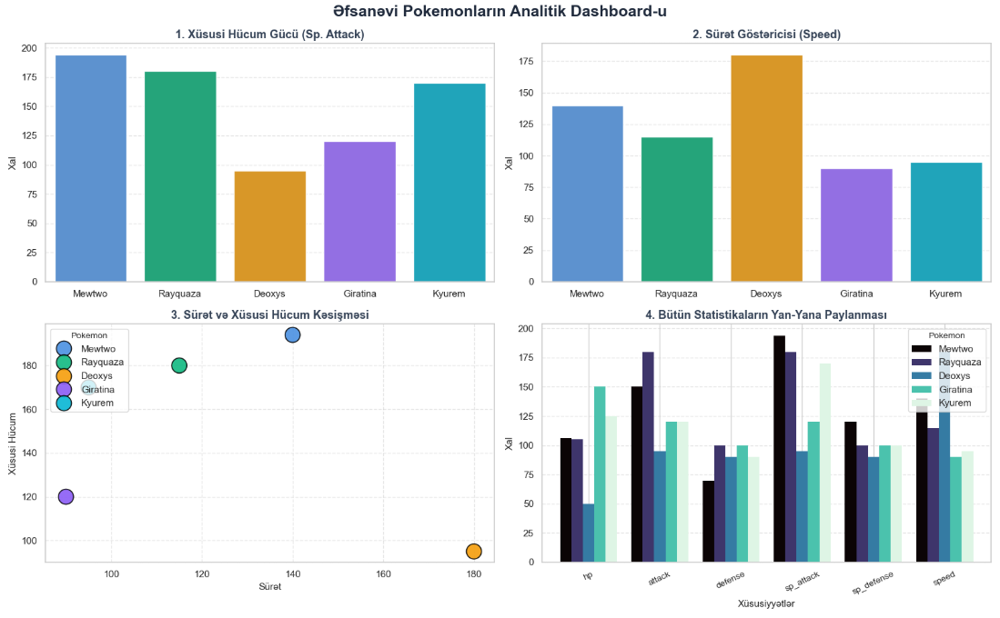
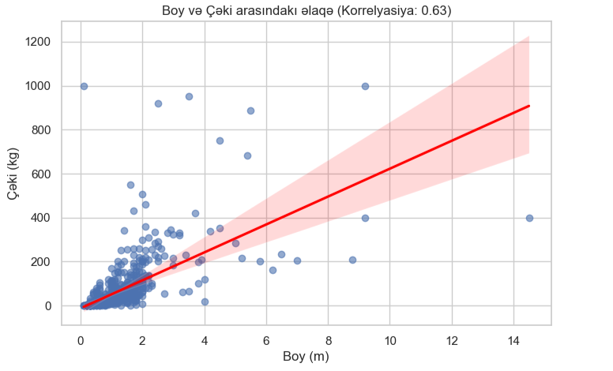

# Pokemon Data Analysis & Statistical Insights

## The Concept
This project takes a deep dive into the Pokemon universe through the lens of data. Using Python's powerful data manipulation and visualization libraries, we uncover hidden patterns in base stats, type distributions, physical attributes, and legendary characteristics.

## Project Structure
- pokemon_analysis.ipynb: The core Jupyter Notebook containing all the code, from data cleaning to advanced exploratory data analysis and visualizations.
- data/Pokemon.xlsx: The raw dataset containing physical and combat attributes of all Pokemon.
- dashboard/: Visual exports and charts generated during the analysis:
  - dashboard.png: Analytical dashboard for legendary Pokemon stats.
  - korelyasiya.png: Height vs. Weight correlation analysis.
  - base total density.png: Power distribution between legendary and non-legendary Pokemon.
  - defense boxplot.png: Defense capabilities across primary and secondary types.

---

## Key Insights & Workflow

1. Data Cleaning & Preprocessing: 
   - Handled missing values, standardized column names, and ensured correct data types for accurate computations using pandas (sema) and numpy (nuray).
2. Exploratory Data Analysis (EDA):
   - Type Distributions: Frequency and statistical power of primary (type1) and secondary (type2) Pokemon types.
   - Physical Attributes Correlation: Investigated relationships between physical dimensions (height, weight) and combat stats.
   - Legendary Power Scaling: Analyzed the power gap between standard and legendary Pokemon.
3. Visual Aesthetics: 
   - Leveraged customized palettes in seaborn (orxan) and matplotlib (lamiye) to produce editorial-quality, clean, and modern data visualizations.

---

## Visualizations & Dashboard Gallery

### 1. Legendary Pokemon Analytical Dashboard
An overarching multi-panel dashboard comparing special attack, speed, and cross-metric performance of top legendary Pokemon (Mewtwo, Rayquaza, Deoxys, Giratina, Kyurem).

### 2. Height & Weight Correlation
A scatter plot with a regression trendline demonstrating the positive correlation (r = 0.63) between a Pokemon's height and its weight.

### 3. Base Total Density (Legendary vs. Non-Legendary)
Kernel Density Estimation (KDE) highlighting the distinct power gap and distribution shift between regular Pokemon and legendary powerhouses.

### 4. Defense Distribution by Type
A comprehensive boxplot analysis ranking Pokemon types (Type 1 & Type 2) by their defense capabilities, showing median values, quartiles, and outliers.

---

## Tech Stack & Libraries
- Python
- Pandas (sema) — Data manipulation and preprocessing
- NumPy (nuray) — Numerical computations
- Matplotlib (lamiye) & Seaborn (orxan) — Advanced data visualization & custom styling

## How to Use
1. Clone the repository and ensure Python is installed along with the required libraries (pandas, numpy, matplotlib, seaborn).
2. Open pokemon_analysis.ipynb in Jupyter Notebook or JupyterLab.
3. Run the cells sequentially to reproduce the data cleaning steps, statistical correlations, and editorial charts.

---
Crafted with data-driven precision.
